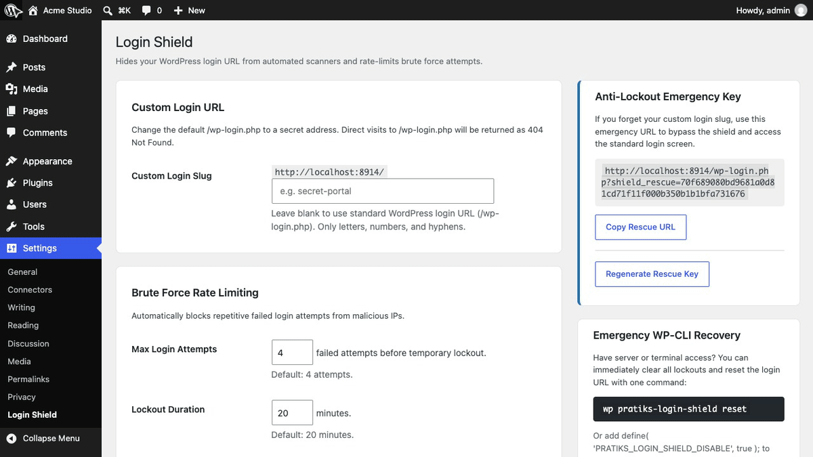
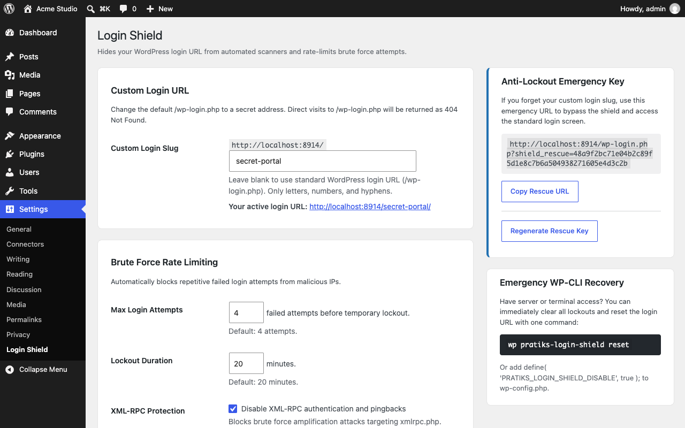
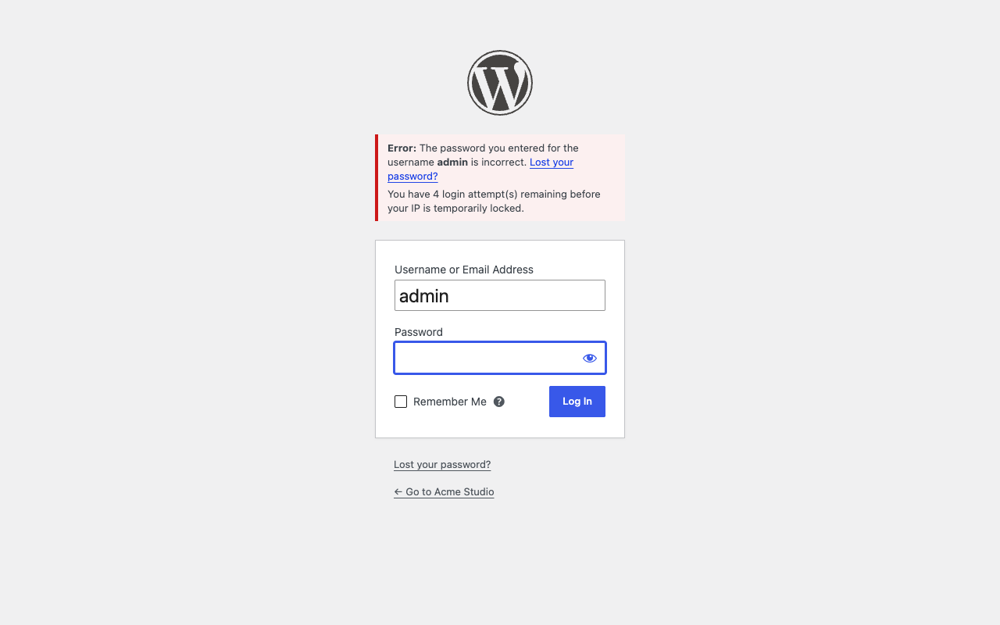

<p align="center"></p>

<h1 align="center">Pratiks Login Shield</h1>

<p align="center">
  <a href="https://playground.wordpress.net/?blueprint-url=https://raw.githubusercontent.com/pratik-londhe4/pratiks-login-shield/main/blueprint.json"></a>
  <a href="https://github.com/pratik-londhe4/pratiks-login-shield/releases/latest"></a>
  
  
  <a href="LICENSE.md"></a>
  <br>
  <a href="https://github.com/pratik-londhe4/pratiks-login-shield/actions/workflows/phpcs.yml"></a>
  <a href="https://github.com/pratik-londhe4/pratiks-login-shield/actions/workflows/phpstan.yml"></a>
  <a href="https://github.com/pratik-londhe4/pratiks-login-shield/actions/workflows/unit-tests.yml"></a>
  <a href="https://github.com/pratik-londhe4/pratiks-login-shield/actions/workflows/e2e-tests.yml"></a>
  <a href="https://github.com/pratik-londhe4/pratiks-login-shield/actions/workflows/plugin-check.yml"></a>
</p>

<p align="center">Protect WordPress from brute force attacks with custom login URLs, rate limiting lockouts, and emergency anti-lockout recovery.</p>

<p align="center">
  
</p>

---

WordPress sites face non-stop automated bot attacks probing `/wp-login.php` with credential stuffing and dictionary attacks. These bot scans waste server bandwidth, overwhelm error logs, and expose site accounts to brute-force compromise.

While URL-hiding plugins like WPS Hide Login exist, they suffer from a dangerous flaw: **if you forget your slug or a rewrite rule breaks, you are permanently locked out** and forced to access cPanel or FTP to rename the plugin folder. Moreover, URL hiding alone provides zero rate limiting once the page is found or if attackers probe XML-RPC.

**Pratiks Login Shield** provides a complete, modern, zero-bloat security shield:

1. **Custom Login URL**: Mask `/wp-login.php` behind any secret slug (e.g. `https://example.com/secret-portal/`). Direct requests to `/wp-login.php` return a standard `404 Not Found`.
2. **Brute Force Rate Limiting**: Automatically track failed authentication attempts per IP address. When failed attempts reach your limit (default: 4 attempts), the IP is temporarily locked out for your chosen window (default: 20 minutes).
3. **Anti-Lockout Emergency Key**: Every site generates a private rescue URL token (`https://example.com/wp-login.php?shield_rescue=<key>`) that immediately bypasses the shield, ensuring administrators are never locked out.
4. **XML-RPC Multicall Protection**: Block XML-RPC authentication and strip pingback headers with one click to stop brute-force amplification attacks.

> [!NOTE]
> Free and open source under GPLv2+. No pro version, no upsells, no ads, no telemetry. Clean, lightweight, and accessible.

## Features

- **Custom Login URL**: Change your login address with live preview. Preserves `action=postpass` for password-protected posts and filters core login URLs seamlessly.
- **Brute force rate limiting**: Shows visitors how many attempts remain on incorrect passwords before lockout, and displays remaining lockout minutes when blocked.
- **Anti-lockout guarantees**: Bookmark your secret Emergency Rescue URL, run `wp pratiks-login-shield reset` from terminal, or set `PRATIKS_LOGIN_SHIELD_DISABLE` in `wp-config.php`.
- **XML-RPC protection**: Easily toggle XML-RPC off to prevent automated bots from bypassing the login page via `xmlrpc.php`.
- **Active lockouts dashboard**: Under **Settings > Login Shield**, inspect locked IPs, failed attempts, targeted usernames, and unlock any IP in one click.
- **WP-CLI support**: Inspect status, unlock individual IPs, or reset all settings to defaults directly from the command line.
- **WordPress 6.9+ Abilities API**: Register security status check and unlock abilities for autonomous AI agents and MCP workflows.
- **Privacy & GDPR compliance**: Failed attempts and lockouts automatically expire and clear. Full integration with WordPress Core Personal Data Exporter and Eraser.
- **Accessibility**: 100% WCAG 2.1 AA compliant, tested with axe-core.

## Installation

1. Download `pratiks-login-shield.zip` from the [latest release](https://github.com/pratik-londhe4/pratiks-login-shield/releases/latest).
2. In WordPress, go to **Plugins > Add New Plugin > Upload Plugin**, choose the zip and activate it.
3. Navigate to **Settings > Login Shield** to choose your custom login slug and rate limiting rules.
4. Bookmark your secret **Emergency Rescue URL**.

Or with WP-CLI:

```sh
wp plugin install https://github.com/pratik-londhe4/pratiks-login-shield/releases/latest/download/pratiks-login-shield.zip --activate
```

Requires WordPress 6.6+ and PHP 7.4+. The **Try in WordPress Playground** badge opens a throwaway WordPress site directly in your browser with the plugin active and ready to test.

## WP-CLI

Manage Login Shield settings, lockouts, and emergency recovery from the terminal:

```sh
# View current status, custom login URL, and active lockouts
wp pratiks-login-shield status

# Unlock a specific IP address
wp pratiks-login-shield unlock 192.168.1.100

# Emergency reset: restore default /wp-login.php and clear all lockouts
wp pratiks-login-shield reset
```

## Anti-Lockout Guarantees

Getting locked out of your site is the #1 risk with login hiding tools. Login Shield guarantees 3 fail-safe recovery methods:

1. **Rescue URL**: Visit your secret emergency bookmark (`/wp-login.php?shield_rescue=<secret_key>`).
2. **WP-CLI Command**: Run `wp pratiks-login-shield reset` from SSH or server terminal.
3. **wp-config.php Constant**: Add `define( 'PRATIKS_LOGIN_SHIELD_DISABLE', true );` to bypass shielding instantly.

## Screenshots

<table>
  <tr>
    <td width="33%" valign="top"> Login Shield"><br><sub>1. Settings screen with custom slug, rate limiting, and active lockouts table</sub></td>
    <td width="33%" valign="top"><br><sub>2. Custom login URL with remaining failed attempts notice</sub></td>
    <td width="33%" valign="top"><br><sub>3. Temporary IP lockout screen with remaining duration countdown</sub></td>
  </tr>
</table>

## Documentation

| Doc | What it covers |
| --- | --- |
| [Reference](docs/REFERENCE.md) | Actions, constants, WP-CLI commands, and Abilities API |
| [Development](docs/DEVELOPMENT.md) | Local environment, commands, PHPCS, PHPStan, and tests |
| [Contributing](docs/CONTRIBUTING.md) | Pull requests, required checks, and PR titles |
| [Releasing](docs/RELEASING.md) | How Conventional Commits and pull requests become releases |
| [Security](docs/SECURITY.md) | Reporting a security vulnerability |
| [readme.txt](readme.txt) | WordPress.org plugin directory description, FAQ, and changelog |

## Project structure

```
pratiks-login-shield.php          plugin header, autoloader, activation & boot
uninstall.php                    clean removal of options and transient data
src/
├── Plugin.php                   service container and lifecycle bootstrap
├── Service.php                  service contract interface
├── Auth/
│   ├── LoginUrlHandler.php      custom login slug rewriting and /wp-login.php blocking
│   ├── RateLimiter.php          IP-based brute-force tracking and lockout enforcement
│   └── XmlRpcBlocker.php        XML-RPC method blocking and pingback header removal
├── Settings/
│   └── SettingsPage.php         admin settings controller under Settings > Login Shield
├── Cli/
│   └── Command.php              WP-CLI command suite (status, reset, unlock)
├── Abilities.php                WordPress 6.9+ Abilities API and agent definitions
└── Privacy.php                  GDPR personal data exporter, eraser, and privacy text
tests/
├── Unit/                        PHPUnit test cases with Brain Monkey isolation
└── e2e/                         Playwright test harness and Docker multi-version matrix
scripts/                         brand assets and icon generator
docs/                            reference, development, contributing, releasing
```

## More free plugins

| | Plugin | What it does |
| --- | --- | --- |
|  | [Pratiks Block Grammar Editor](https://github.com/pratik-londhe4/pratiks-block-grammar-editor) | Inspect, copy, format, validate, and edit Gutenberg block comment grammar for individual blocks in the editor |
|  | [Pratiks Options Revisions](https://github.com/pratik-londhe4/pratiks-options-revisions) | Track settings changes, compare unified diffs, and roll back any WordPress or plugin option with one click |
|  | [Pratiks 3D Model Embedder](https://github.com/pratik-londhe4/pratiks-3d-model-embedder) | Upload GLB, glTF, STL and OBJ files and show them in posts as interactive 3D models visitors can rotate |

## License

Copyright (c) Pratik Londhe. Licensed under [GPL-2.0-or-later](LICENSE.md).
